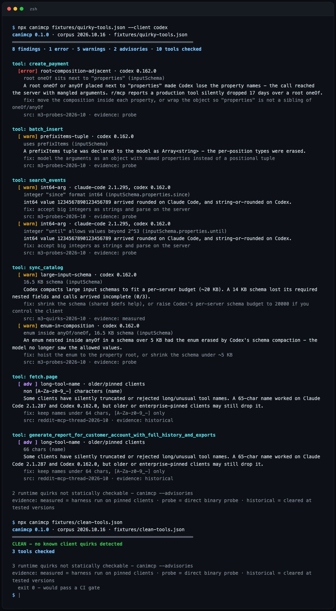

# canimcp

**`npx canimcp` checks an MCP server's tool list against a versioned corpus of client quirks - the schema shapes that make Claude Code or Codex silently drop, mangle, or never see your tools. Caniuse, for MCP.**



The bug reports are consistent: "the tool doesn't show up in Claude Code", "Codex stopped calling it after an update", and no error on either side. One r/mcp author had a tool silently absent for **17 days** over a root `oneOf`. SineFrame ran Claude Code and Codex against ten MCP servers at pinned versions and found **5 of 10 features split the two clients - and they never failed the same one**.

canimcp is the static preflight for that. Feed it a `tools/list` response, or point it at your server command, and it reports which clients break on what - every rule scoped to the client version it was measured on, with the evidence and a fix.

## install / run

```bash
npx canimcp tools.json                  # a saved tools/list response or bare tools array
npx canimcp --cmd "node server.js"      # spawn your stdio server, check its live tools/list
npx canimcp --cmd "npx -y @modelcontextprotocol/server-filesystem ~"
my-server --dump-tools | npx canimcp    # check JSON on stdin
```

Zero dependencies. Node 18+.

Exit code is `1` when a finding hits `--fail-on` severity (default `error`), so it gates CI:

```yaml
- run: npx canimcp tools.json --format github --fail-on error
```

## what it checks (corpus `2026.10.16`)

| rule | sev | breaks on | what it catches | evidence |
|---|---|---|---|---|
| `arg-name-brackets` | error | Claude Code 2.1.287 | `ids[]`-style argument names - the tool silently vanishes (0/3 runs) | measured |
| `missing-root-type` | error | Claude Code 2.1.295 | inputSchema with no root `type` drops the *whole server's* tool list | probe |
| `root-composition-adjacent` | error | Codex 0.162.0 | root `oneOf`/`anyOf` next to `properties` - property names lost | probe |
| `tool-count-overflow` | error | Codex 0.162.0 | more than 2048 tools on one server - the rest are dropped | probe |
| `large-input-schema` | warn | Codex 0.162.0 | ~14 KB+ input schemas get compacted; required nested fields lost (0/3) | measured |
| `enum-in-composition` | warn | Codex 0.162.0 | `enum` inside `anyOf`/`oneOf` in >5 KB schemas gets erased | probe |
| `prefixitems-tuple` | warn | Codex 0.162.0 | `prefixItems` degraded to `Array<string>` | probe |
| `int64-arg` | warn | CC 2.1.295, Codex 0.162.0 | integer args beyond 2^53 arrive rounded or as strings | probe |
| `similar-tool-names` | warn | Claude Code 2.1.295 | `fetch.page` vs `fetch_page` - one gets misrouted | probe |
| `outputschema-fidelity` | advisory | Claude Code 2.1.287 | text+structuredContent results lose the text; outputSchema + text-only result becomes an error | measured |
| `long-tool-name` | advisory | older/pinned clients | >64 chars / non-`[A-Za-z0-9_-]` names - cleared at current versions, not guaranteed on pinned ones | historical |

`--advisories` lists runtime quirks a schema can't reveal (Codex's stale tool catalog after `tools/list` changes, Claude Code truncating the middle of >10 KB tool errors, Codex code mode never seeing your JSON Schema).

## the corpus is the product

Rules live in [`src/corpus.json`](src/corpus.json), not in code. Every entry carries:

- the client + version it was reproduced on (clients drift; last month's quirk may be this month's non-issue - the m3 run *cleared* two old suspects)
- `evidence`: `measured` (harness run against pinned binaries, trials/cell) · `probe` (direct binary probe, a lead until measured) · `historical` (cleared at tested versions) · `field-report` (user report, unverified)
- the source URL and a suggested fix

`canimcp --corpus` prints the corpus version and every evidence source.

**PR a rule with a reproduction.** A corpus entry needs: the quirk, the client version(s) it fires on, a link to the reproduction (run log, wire trace, issue), and a `detect` descriptor - or just the evidence and the descriptor gets written in review.

## limitations

- **Static, not live.** This is the preflight, not the integration test. It sees your schema, not what your server returns at runtime or what a given client build does tonight. For live trials against real client binaries, see [M3](https://github.com/sineframe/m3) - this tool is the fast pass that runs in CI before that.
- **Two clients seeded.** The corpus currently covers Claude Code and Codex because that's what the published evidence covers. Cursor, Gemini CLI, OpenCode etc. need reproductions before rules can cite versions.
- **Probe evidence is a lead, not a verdict.** `probe`-grade rules fired in direct binary probes but haven't been harness-measured. They're flagged as such in output.
- **English-language corpus, JSON Schema only.** It lints `tools/list` shapes. It does not inspect resources, prompts, or auth flows.
- **Generated-schema edge cases.** `$ref` resolution handles local `#/$defs`/`#/definitions`; external refs are left as-is and may hide findings.

## agent skill

Also on [Agensi](https://www.agensi.io/skills/canimcp) as an installable agent
skill: same lint, packaged with a runner script and a quirk playbook so your
agent can check and fix in one step.

## related

- [mcp-bouncer](https://github.com/princejain756/mcp-bouncer) - runtime policy for MCP servers (allowlists, path/URL rules, rate limits, audit log)
- [SineFrame M3](https://github.com/sineframe/m3) - the dynamic harness behind the quirks matrix this corpus seeds from
